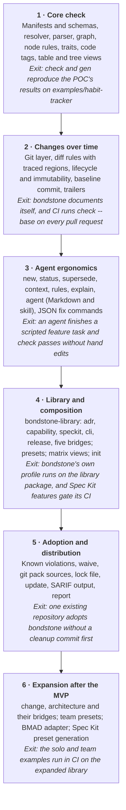

# Bondstone: design

Status: accepted on 2026-11-10 · Branch: `v1`

## Status and how to review

This proposes bondstone v1, a fresh implementation that keeps the POC's core model and adds what the design sketch had and the POC lacked. It draws on two sources:

- **The `POC` branch** is a working Python engine with self-hosted docs, 54 tests and 10 change proposals. Its model held up: packs, bridges, traits, roles, profile-level diff rules and code tags.
- **The design sketch** was formats only. It contributed agent context, declared exemptions, status-aware coverage, richer views, change kinds in diff rules, machine-applicable fixes, grandfathering and an architecture pack.

Where they disagreed, this proposal follows the POC unless it says otherwise. Every point that needs your call is a numbered decision (D1, D2, ...) collected in the last section. All 14 decisions were accepted on 10 November 2026, so this document is the basis for implementation, starting with phase 1.

## Problem, goals and non-goals

Bondstone is a CLI that keeps a repository's living documentation true, by checking it against rules stored in the same repository. Agents run it to validate their own work; git hooks and CI run it as a gate.

It addresses two problems with spec-driven tools:

1. **No living doc.** Per-change artifacts are written once and never folded back into a description of what is true today: the decision log, capability specs, architecture.
2. **Loose format and links.** Required content and links between documents are conventions that nothing checks.

### Goals

| # | Goal | How we know it is met |
| --- | --- | --- |
| G1 | Living docs stay current | A change to code traced to a document fails the gate unless that document changes or an exemption is declared. |
| G2 | Structure is strict | Every document under a managed folder has a type, valid fields, required sections and typed links. A broken link is an error. |
| G3 | Methods compose | A solo app, a team and an organisation use different combinations of packs, and no pack names another. |
| G4 | Agents get it right first time | An agent can list the rules, scaffold a document, ask what to read before editing, and act on JSON diagnostics that carry a fix. |
| G5 | Spec Kit and BMAD stay inside the rules | Their artifacts are checked like any document, and their templates are generated from the active packs. |
| G6 | Adoption is incremental | An existing repository can adopt bondstone without fixing every old document first. |

### Non-goals

- **A workflow engine.** Bondstone decides whether a result is acceptable, not how the work is done. Spec Kit, BMAD or a person own the process.
- **LLM judgement in the gate.** `check` is deterministic. A separate review command may come later and never fails the build.
- **A hosted service or UI.** Output is files in the repository; any portal is built on `bondstone graph`.
- **Formats other than Markdown with YAML frontmatter** in v1.
- **Automatic merging of change deltas into living docs** in v1 (see D7).

## Design principles

Ten principles decide the cases this document does not cover. The first three come from the POC's ADRs and proved themselves there.

1. **The engine knows no methodology.** It never mentions a specific method such as ADR. It loads documents into a typed graph and evaluates rules.
2. **Methods are packs, and packs never know each other.** Everything that connects two packs (cross-pack links, hand-off rules, cross-pack views) lives in a **bridge**.
3. **No shared ontology.** Mechanical behaviour comes from engine-defined **traits**. Generic meaning comes from **roles**, which bridges and profiles assign to concrete types.
4. **The repository owns its rules.** Packs, bridges, overrides and waivers are files in the repository, pinned by version, reviewed like code.
5. **The gate is deterministic.** The same commit gives the same result on every machine. No network access during `check`, no model calls.
6. **Living docs are edited in place; git is the history.** Per-change records are optional: a `change` pack is one method among others, not part of the engine.
7. **Derived content is generated, never written.** Views, agent instructions and tool templates come from the graph and the packs; `check` fails when they are stale.
8. **Every diagnostic is actionable.** It names a rule, a location and a hint, and a command when one command fixes it.
9. **Exemptions are explicit and visible.** A waiver has a reason and an expiry date; a diff-rule exemption sits in the commit history. Nothing is silently skipped.
10. **Strict by default, loosened by the profile.** Unknown frontmatter keys, untyped files in managed folders and unknown rule ids are errors until the profile says otherwise.

## Concepts

A profile selects packs and bridges; together they define types, links, rules and views; the engine reads documents and code into one graph and checks the rules against it.

```mermaid
flowchart LR
  subgraph rules["Rules (in the repository)"]
    profile["Profile and presets<br/>packs, bridges, overrides"] --> packs["Packs and bridges<br/>types, links, rules, views"]
  end
  subgraph content["Content"]
    docs["Documents<br/>Markdown with frontmatter"]
    code["Code tags<br/>comments: bondstone: ID"]
  end
  graph["Typed graph and rules<br/>nodes, links, code regions"]
  packs --> graph
  docs --> graph
  code --> graph
  graph --> check["check<br/>diagnostics and exit code"]
  graph --> gen["gen<br/>generated Markdown views"]
  graph --> agent["agent<br/>AGENTS.bondstone.md"]
  graph --> context["context<br/>what to read before editing"]
```

Everything left of the graph is configuration under version control; everything right of it is derived and can be regenerated.

| Concept | What it is | Defined by |
| --- | --- | --- |
| **Document** | A Markdown file with YAML frontmatter. Its type comes from the path it lives at. | Author |
| **Item** | A heading inside a document that becomes its own node, such as `### REQ-REM-001: Remind at the usual time` inside a capability spec. Items can be linked to and tagged in code. | Pack (type) |
| **Node** | A document or an item, with an id, a type, fields, sections and links. | Engine |
| **Type** | What a node must look like: id template, path, fields, sections, traits. Named `pack:Type`, such as `adr:Decision`. | Pack |
| **Link** | A typed edge, written once in the frontmatter of the source node as a list of ids. | Pack or bridge |
| **Pack** | One method: its types, links, rules, views, templates and agent guidance. | Library, the repository, or a git source |
| **Bridge** | What connects two or more packs: cross-pack links, roles, hand-off rules and views. Defines no types. | Same as packs |
| **Profile** | What one repository uses: packs, bridges, presets, code paths, repository rules, overrides, waivers. | Repository |
| **Preset** | A partial profile that profiles extend, for standards shared across repositories (an organisation's locked rules). | Organisation |
| **Trait** | Engine-defined behaviour a type opts into: `lifecycle`, `owned`, `immutable`, `supersedable`, `code-traceable`, `indexed`. | Engine |
| **Role** | A name such as `living-spec` or `decision`, mapped to concrete types so generic rules work across packs. | Bridge or profile |
| **Rule** | A requirement on nodes (node rule), on a change (diff rule), or on files (existence rule). | Pack, bridge, preset or profile |
| **View** | Generated Markdown: an index, a tree or a matrix. Stale views fail `check`. | Pack, bridge or profile |
| **Code tag** | A comment `bondstone: REQ-REM-001` in source code. The block below it is that node's code region. | Author |

Only types live in packs. Roles never live in packs, so a pack cannot assume what it will be combined with.

## File formats

There are three manifest kinds: `pack.yaml`, `bridge.yaml` and `profile.yaml`. Each has a JSON Schema shipped with bondstone, and `bondstone profile check` adds the checks a schema cannot express, such as whether a referenced type exists.

### Repository layout

```text
.bondstone/
  profile.yaml          what this repository uses
  bondstone.lock        resolved versions and hashes of non-local packs
  known.json            grandfathered violations (optional, see Adoption)
  packs/<id>/           local packs and bridges
    pack.yaml | bridge.yaml
    templates/*.md
    instructions.md     guidance merged into the agent instructions
    fixtures/<case>/    sample repositories with expected diagnostics
docs/                   documents (any folders the packs declare)
docs/generated/         views (default location)
```

### pack.yaml

```yaml
id: adr
version: 1.0.0
bondstone: ">=1.0"                    # engine versions this pack works with
description: Architecture decision records with a lifecycle and supersession.

types:
  Decision:
    description: One architecturally significant decision and its rationale.
    id: "ADR-{n:03d}"                  # pattern derived: ^ADR-\d{3,}$
    path: "docs/adr/{id}-{slug}.md"    # match glob derived: docs/adr/*.md
    template: templates/decision.md
    fields:                             # JSON Schema properties
      title: {type: string, minLength: 3}
      date: {type: string, format: date}
      deciders: {type: array, items: {type: string}}
    required: [title, date]
    sections: [Context, Decision, Alternatives considered, Consequences]
    traits:
      lifecycle:
        statuses: [proposed, accepted, rejected, deprecated, superseded]
        initial: proposed
        transitions:
          proposed: [accepted, rejected]
          accepted: [deprecated, superseded]
      owned: {}
      supersedable: {link: supersedes}
      immutable: {when: [accepted, rejected, deprecated, superseded], allow: [status]}
      indexed: {}

links:
  supersedes: {from: Decision, to: Decision, max: 1, description: The decision this one replaces.}

rules: []          # see Rules
views: []          # see Views
instructions: instructions.md
```

A type with items declares where they are and how their ids look:

```yaml
  Capability:
    id: "CAP-{slug}"
    path: "docs/capabilities/{slug}.md"
    fields: {title: {type: string}, code: {type: string, pattern: "^[A-Z]{2,6}$"}}
    required: [title, code]
    items:
      type: Requirement
      section: Requirements           # items are only read under this heading
      heading: "### {id}: {title}"
      id: "REQ-{code}-{n:03d}"        # {code} = a field of the parent
  Requirement:
    embedded: true
    traits: {code-traceable: {coverage: warn, when: [active]}}
```

### bridge.yaml

```yaml
id: adr-capability
version: 1.0.0
bondstone: ">=1.0"
requires: {adr: "^1", capability: "^1"}

links:
  constrained_by: {from: capability:Capability, to: adr:Decision}
roles:
  decision: [adr:Decision]
  living-spec: [capability:Capability]
rules:
  - id: constrained-by-live-decision
    description: Capabilities are constrained only by proposed or accepted decisions.
    when: {type: capability:Capability}
    require: [{link: constrained_by, all: true, to: {type: adr:Decision, status: [proposed, accepted]}}]
    hint: Point to the decision that superseded it.
views: []
instructions: instructions.md
```

### profile.yaml

```yaml
bondstone: 1
extends: [starter@1]                     # optional presets (D4)
packs: [release@1, runbooks@0.1]         # library or local; none is required
bridges: []
sources: [.bondstone/packs]              # searched before installed libraries
docs: ["docs/**/*.md"]                   # managed: an untyped file here is an error
code:
  include: ["app/lib/**/*.dart"]
  exclude: ["**/*.g.dart"]
defaults: {owner: dawid}
roles: {}                                # extra role assignments
rules: []                                # repository rules, usually diff rules
views: []
overrides:
  adr/alternatives-considered: warn
waivers:
  - rule: adr-capability/accepted-decision-is-applied
    node: ADR-001
    reason: Organisation-wide decision that constrains no single capability.
    expires: 2027-06-30
```

### Changes from the POC formats

| POC | Proposed | Why |
| --- | --- | --- |
| `id_format` and `id_pattern` | `id` template; pattern derived, `id_pattern` only to override | One source for scaffolding and validation (D8). |
| `paths`, `dir`, `filename` | `path` template; match glob derived | Same reason; one place to read where a type lives. |
| `required_fields` | `required` | Matches JSON Schema. |
| `{severity: off}` overrides | Bare severity: `error`, `warn`, `info`, `ignore` | YAML reads `off` as `false`, which the POC rejected (D3). |
| `bondstone: 0.1` (a float) | `bondstone: 1` (an integer) | Format version, not engine version. |
| No managed folders | `docs:` globs | Catches documents that match no type. |
| No presets | `extends:` | Shared organisational standards (D4). |

## Rules

A rule selects something and requires something of it. Three kinds cover the cases seen in the POC and the sketch; all share `id`, `description`, `severity`, `locked`, `hint` and `fix`.

| Kind | Selects with | Runs | Example |
| --- | --- | --- | --- |
| Node rule | `when:` a selector | Always | A concluded experiment has a Result section. |
| Diff rule | `on_change:` paths and change kinds | With `--base` | Code changed in a tagged region; the traced spec must change too. |
| Existence rule | `for_each:` a glob of files | Always | Every `pack.yaml` in the library has a README document. |

### Selectors

Selector keys combine with AND: `type`, `role`, `trait`, `status`, `where: {field: value}` (a list means any of), and `covered: true|false`. Type names are unqualified inside their own pack and qualified everywhere else.

### Clauses

| Clause | Holds when | New in v1 |
| --- | --- | --- |
| `link: L, to: SEL, min: N` | At least N outgoing L links point at nodes matching SEL. |  |
| `link: L, to: SEL, all: true` | Every outgoing L link points at a node matching SEL. |  |
| `incoming: L, from: SEL, min: N` | At least N incoming L links come from nodes matching SEL. |  |
| `field: F` | The field is present and not empty. |  |
| `section: S` | The heading exists. |  |
| `contains: REGEX` | The body matches. |  |
| `items: {type, min}` | The document has at least N items of a type. | Yes |
| `covered: true` | The node is tagged in code. | Yes (D9) |
| `file_field: {path, key, equals}` | A value in a YAML or JSON file equals a field. |  |
| `any: [...]` | At least one alternative holds. |  |
| `changed: SEL, min: N` | Diff rules: N changed documents match SEL. |  |
| `changed: SEL, traced: true` | Diff rules: every document matching SEL that is tagged in a changed code region also changed. |  |
| `exists: SEL, min: N` | Diff rules: N documents match SEL, changed or not. |  |

### Diff rules

```yaml
- id: code-change-updates-living-spec
  description: Changing app code updates the living specs that code implements.
  on_change:
    paths: ["app/lib/**"]
    kinds: [added, modified, deleted]   # new in v1; default: all three
  require:
    - changed: {role: living-spec}
      traced: true
      min: 1
  exempt: {trailer: Spec-Impact}        # new in v1, see D5
  hint: Update the spec, or add the trailer "Spec-Impact: none (<reason>)".
```

`exempt` lets a single change skip the rule with a declared reason; see Exemptions below.

### Exemptions for diff rules (D5)

An exemption lets one change pass a diff rule without a documentation update, by saying why in the commit itself. It exists because traced diff rules fire on any edit inside a tagged code region, and many edits change no behaviour.

**The problem it solves.** Renaming a function, moving code between files, bumping a dependency or reformatting all touch tagged regions. Without an exemption the author has two bad options:

- **Edit the spec for nothing.** Trivial edits to living docs create noise that hides the real updates, and agents learn to make them by reflex.
- **Weaken the profile.** An override or a waiver is permanent and applies to every future change, where the exception was meant for one.

**How it works.**

1. **The rule opts in.** Only rules that declare `exempt: {trailer: <name>}` can be exempted. A rule without `exempt` has no escape hatch, and a preset can omit it for rules that must always hold.
2. **The author adds a git trailer** to any commit in the checked range (`--base..HEAD`):

   ```text
   Move reminder scheduling into its own module
   
   Spec-Impact: none (pure move, no behaviour change)
   ```
3. **The value must be `none (<reason>)`** with a non-empty reason. Anything else is reported as `bondstone/exemption-invalid` (error), so a typo cannot silently exempt or silently fail.
4. **Scope is the whole range by default.** `Spec-Impact: none [CAP-reminders] (rename only)` narrows it to diagnostics on the listed nodes, so one refactor cannot hide an unrelated missing update in the same pull request.
5. **Nothing disappears from the output.** Exempted diagnostics are reported as `info` under `bondstone/exemption-used`, naming the commit, rule, nodes and reason. JSON adds `exempted_by: {commit, trailer, reason}`.
6. **Use is measured.** `bondstone report --base REF` counts exemptions per rule and per author, so a team can see when the hatch is used as a habit.

**Why a commit trailer.** It sits in history next to the change it excuses and is visible in code review. It is read with `git log` and needs no server, so `check` stays offline and gives the same result locally and in CI (principle 5). Git already uses trailers this way for `Signed-off-by` and `Co-authored-by`.

**Alternatives considered.**

| Option | Why not |
| --- | --- |
| Waivers only | Permanent and per node; reviewers see a policy change instead of an explanation for one change. |
| A pull request label | Needs the forge's API; results differ locally and in CI, and the label is not in git history. |
| An ignore comment in code | Pollutes the code and outlives the change it was meant for. |
| Trivial spec edits | The noise this mechanism exists to avoid. |

**Safeguards against overuse.**

- The generated agent instructions tell agents not to add exemption trailers unless the user asked for one.
- `check --no-exemptions` ignores all trailers, for CI jobs or release branches that must be strict.
- Squash merges keep trailers only if the squashed message keeps them. Pull request CI checks the branch commits, so the gate still sees them; after a squash merge, history keeps whatever the merge message contains.

### Severities and overrides

- **Severities:** `error` fails the run, `warn` fails only with `--fail-on warn`, `info` is listed and never fails, `ignore` disables (D3).
- **Overrides:** the profile, or a preset it extends, changes a rule's severity by its qualified id.
- **Locked rules:** `locked: true` means overrides may raise the severity but not lower it, and waivers do not apply. Presets use this for organisation-wide rules.
- **Order:** rule default, then presets in `extends` order, then the profile.

### Engine rules

Engine checks are rules too, named `bondstone/...`, listed by `bondstone rules`, explained by `bondstone explain`, and overridable unless locked. The POC's catalogue (38 entries in engine\_rules.md) carries over. New ones: `bondstone/untyped-document` (a file under `docs:` matches no type) and `bondstone/exemption-used` (info) and bondstone/exemption-invalid (error).

## Code traceability, views and agent instructions

These three are what make the docs "living": code points at documents, indexes are never written by hand, and agents are told the rules in the form the rules are enforced.

### Code traceability

- **Tags.** A comment containing `bondstone: REQ-REM-001, REQ-REM-002` ties code to nodes. Any comment syntax works; the tag regex is the same in every language.
- **Regions.** A tag's region is the block of code below it, ending where indentation returns to the tag's level or the next tag starts. Diff rules with `traced: true` use regions, so editing one function does not demand updates to every spec tagged in the file.
- **Checks.** A tag with an unknown id is an error; a tag on a type without `code-traceable` is an error.
- **Coverage depends on status** (D9). `code-traceable: {coverage: warn, when: [active]}` reports uncovered nodes only in the listed statuses, so a planned building block needs no code yet and a live one does.

### Coverage that depends on status (D9)

Coverage asks whether a node is implemented somewhere in code. D9 makes that question depend on the node's status, because a requirement that is only planned should not have code yet.

**The problem it solves.** In the POC, `code-traceable: {coverage: warn}` applies to every node of a type. A spec written before its code, which is what Spec Kit encourages, immediately reports "REQ-REM-003 is not referenced from code". Teams then pick one of two bad fixes:

- **Turn coverage off for the whole type.** Live features lose the check too.
- **Write requirements after the code.** That defeats spec-first development.

**How it works.**

1. **`when` lists the statuses that need code.** Nodes in other statuses are not reported as uncovered. Without `when`, every status is checked, as in the POC.
2. **`retired` lists the statuses that must not have code.** A tag that still points at a removed requirement is reported as `bondstone/tag-retired` (warn): code claims to implement something the spec no longer contains.
3. **Items get their own status.** Requirements are items inside a capability, so they need a lifecycle of their own. An optional `Status:` line under the item's heading sets it. Without the line, the item takes the type's `default` status, which should be the strict one, so forgetting the line never weakens the check.
4. **Lifecycle rules apply to items too.** With `--base`, a requirement moving from `active` back to `planned` is a transition the lifecycle must allow.
5. **Unknown tags stay errors** whatever the status: a tag for an id that does not exist, or for a type that is not code-traceable.

```yaml
Requirement:
  embedded: true
  traits:
    lifecycle:
      statuses: [planned, active, removed]
      default: active          # an item without a Status line is active
      transitions: {planned: [active, removed], active: [removed]}
    code-traceable:
      coverage: error
      when: [active]           # only active requirements must be tagged
      retired: [removed]       # tags pointing at removed requirements warn
```

```markdown
### REQ-REM-003: Snooze a reminder

Status: planned

The app SHALL let the user snooze a reminder for 10, 30 or 60 minutes.
```

**One requirement's life:**

| Moment | Spec | Code | `check` |
| --- | --- | --- | --- |
| A Spec Kit feature adds the requirement | `Status: planned` | No tag | Passes |
| Implementation starts | `Status: planned` | Tag added | Passes |
| The feature is implemented | Status line removed, so `active` | Tagged | Passes; without the tag, an error |
| The requirement is dropped later | `Status: removed` | Tag still there | Warns until the tag or the code goes |

**The `covered` clause** is the targeted version of the same check. The trait gives one blanket rule per type. The clause belongs to a named rule with its own severity, hint, overrides and waivers, for cases such as "a stable CLI command is covered" or, as a selector, "an implemented feature only delivers covered requirements":

```yaml
- id: stable-command-is-implemented
  when: {type: Command, status: stable}
  require: [{covered: true}]
  hint: "Tag the command's handler with `bondstone: {id}`."
```

### Views

Views are Markdown files with a generated header. `bondstone gen` writes them, and `check` fails with `bondstone/view-stale` when one differs from what `gen` would write.

| Layout | Shows | Keys |
| --- | --- | --- |
| `table` | One row per node | `select`, `columns`, `sort` |
| `tree` | Nodes reached by walking links level by level | `select` (roots), `levels: [{link: L} \| {incoming: L}]` |
| `matrix` | Rows × columns, a mark where a link path connects them (new, D10) | `rows`, `cols`, `via: [links]` |

Columns may name fields, `id`, `status`, `parent`, an outgoing link (`realizes`) or an incoming link (`<-satisfies`); link cells render as linked ids (new, D10). Views may write anywhere in the repository, which is how `CHANGELOG.md` is generated from releases.

### Agent instructions

`bondstone agent` writes `AGENTS.bondstone.md` from the active profile: the workflow (scaffold, gen, check), every type with its location, id, fields, sections, statuses and links, every rule with its **effective** severity after presets and overrides, and each component's `instructions.md`. The POC printed default severities here; v1 must not.

The same content can be emitted as a Claude Code skill (`--format skill`), so agents load it on demand instead of carrying it in every context.

## CLI surface

One binary, `bondstone`, with commands grouped by who uses them. Every command takes `--root` and, where it prints results, `--format text|json`.

| Command | Purpose | Phase |
| --- | --- | --- |
| `check [--base REF] [--fail-on warn] [--no-exemptions] [--format text\|json\|sarif]` | Validate everything; with `--base`, also lifecycle, immutability and diff rules. | 1, 2 |
| `gen` | Regenerate views. | 1 |
| `new TYPE --title T [--set k=v]` | Scaffold a document with the next id at the right path. | 3 |
| `status ID NEW` | Change status, refusing transitions the lifecycle does not allow. | 3 |
| `supersede ID --title T` | Create a successor, mark the old node superseded, move incoming links. | 3 |
| `context --for PATH... \| --base REF` | List what to read before editing: nodes traced to that code, their linked decisions and requirements, and the diff rules that will fire. | 3 |
| `rules`, `explain RULE` | List active rules with effective severity and its source; explain one, engine rules included. | 3 |
| `agent [--output F] [--format md\|skill]` | Generate agent instructions. | 3 |
| `graph [--format json\|mermaid]` | Export the graph; the basis for portfolio views. | 3 |
| `report` | Counts: nodes by type and status, coverage, waivers, exemptions used. | 5 |
| `init [--preset NAME]` | Create a profile, empty or from a preset. | 4 |
| `profile check` | Validate the profile, presets, packs and bridges. | 1 |
| `pack test DIR...` | Run fixtures of packs and bridges. | 4 |
| `packs` | List available packs and bridges. | 4 |
| `baseline [REF]`, `baseline --known` | Record the adoption commit; record existing violations. | 2, 5 |
| `waive RULE NODE --reason R --expires D` | Add a waiver. | 5 |
| `update [PACK]` | Resolve remote packs and rewrite the lock file. | 5 |
| `adapter install speckit\|bmad\|claude-code` | Generate tool templates and hooks from the active packs. | 6 |

### Output

Text output is one line per diagnostic, `path:line: severity rule: message`, followed by an indented hint. JSON output has the same fields plus `node` and `fix`:

```json
{
  "summary": {"errors": 1, "warnings": 0, "info": 2, "nodes": 149},
  "diagnostics": [{
    "rule": "bondstone/view-stale",
    "severity": "error",
    "path": "docs/generated/decisions.md",
    "message": "generated view adr/decision-log is out of date",
    "hint": "Run `bondstone gen`.",
    "fix": {"command": ["bondstone", "gen"]}
  }]
}
```

`fix.command` is set only when a single bondstone command resolves the diagnostic, so an agent can run it without interpreting prose. The JSON shape is versioned and documented as part of the public surface.

### Exit codes

| Code | Meaning |
| --- | --- |
| 0 | No violations at or above `--fail-on` |
| 1 | Violations found |
| 2 | Configuration error: invalid profile, pack, preset or lock file |
| 3 | Environment error: not a git repository, `--base` ref missing |

Codes 2 and 3 are separate from 1 so that CI and agents can tell "the work is wrong" from "the checker could not run". The POC exited 2 on configuration errors but reported a missing git ref as an ordinary error with exit 1.

## Integration with agents, Spec Kit, BMAD, hooks and CI

Bondstone constrains other tools at two points: what they are told to produce, and whether what they produced is accepted. CI is the guarantee; everything earlier is there to make the CI result green on the first try.

### Gate points

| Where | Command | Strength |
| --- | --- | --- |
| Agent, before editing | `bondstone context --for <paths>` | Guidance |
| Agent, before finishing | `bondstone check --base <upstream> --format json` | Guidance; the agent fixes until exit 0 |
| Claude Code stop hook | `bondstone check --base <upstream> --format json` | Soft gate: the session continues while errors remain |
| pre-commit | `bondstone check` (no `--base`) | Soft gate: can be skipped locally |
| pre-push | `bondstone check --base @{upstream}` | Soft gate |
| CI on pull requests | `bondstone check --base origin/$BASE --format sarif` | Hard gate; SARIF shows diagnostics on the diff |

CI needs full history (`fetch-depth: 0`) because diff rules and the baseline read older commits.

### Spec Kit and BMAD

Each tool gets an **adapter**: a pack, a bridge, and generated templates.

1. **Adapter pack.** Types for the tool's artifacts, matched by path. Spec Kit's `specs/NNN-name/spec.md` becomes `speckit:Feature` with the id taken from the folder, so it needs no frontmatter. BMAD's PRD, architecture and story files become `bmad:Prd`, `bmad:Architecture` and `bmad:Story`.
2. **Adapter bridge.** Connects those per-change artifacts to the living docs. For example, `speckit-capability` adds `modifies: speckit:Feature → capability:Capability` and a rule that an implemented feature's capabilities changed in the same range.
3. **Generated templates.** `bondstone adapter install speckit` writes a Spec Kit preset whose templates carry bondstone frontmatter, links and a final task to update the living docs and run `check`. The BMAD equivalent is a custom module. Templates and rules come from the same packs, so they cannot drift apart.

Adapters declare the tool versions they were tested with and refuse to install on others. Both tools change their customization mechanisms between releases (D13).

**In the MVP, Spec Kit is the change workflow.** The `speckit` pack and its bridges take the place of the POC's `change` pack: a Spec Kit feature is the per-change record, and the bridges force it to be folded into capabilities, decisions and building blocks. A feature's status is derived from its files, since Spec Kit writes no frontmatter: `specified` once `spec.md` exists, `planned` with `plan.md`, `implemented` when every task in `tasks.md` is ticked. Links that Spec Kit cannot write (`modifies`, `decided_by`) go in a small frontmatter block that the generated templates add. The `change` pack follows after the MVP for teams that do not use Spec Kit.

### Agent instructions in the repository

`AGENTS.md` or `CLAUDE.md` holds one line pointing at `AGENTS.bondstone.md`, which is generated. The generated file tells the agent never to weaken the profile to make a check pass, and to ask instead.

## Adoption, distribution and versioning

An existing repository adopts bondstone in one commit, with three tools for the history it brings; packs travel between repositories as pinned git sources.

### Adoption tools

| Tool | Solves | Mechanism |
| --- | --- | --- |
| **Baseline commit** (POC) | Every document looks new against `main` on the first run, so lifecycle and immutability rules misfire. | `bondstone baseline` stores a commit in the profile. A document absent at `--base` but present at the baseline is compared with its baseline version. |
| **Known violations** (new, D6) | Old documents break many rules; fixing them all first blocks adoption. | `bondstone baseline --known` writes `.bondstone/known.json`: one fingerprint per violation (rule, node, message digest). Matching violations are reported as `info`; new ones fail. `check` warns when an entry no longer matches, so the file only shrinks. |
| **Waivers** (POC) | One deliberate exception that will stay. | Profile entry with rule, node, reason and expiry date. An expired waiver is an error; an unused one is a warning. Locked rules cannot be waived. |

### Known violations (D6)

Known violations let a repository adopt bondstone with its current problems on record and fail only on new ones. Linters solve the same problem with baseline files; this is bondstone's version.

**The problem it solves.** The first `check` in a repository with 200 existing documents can report hundreds of errors: missing sections, broken links, uncovered requirements. Today's options are all poor:

- **Fix everything first.** This blocks adoption for weeks, and new work keeps adding violations while you clean up.
- **Lower severities.** Setting rules to `warn` or `ignore` also removes the gate for new work, which is the reason to adopt.
- **One waiver per violation.** Hundreds of profile entries with invented reasons and expiry dates hide the waivers that matter.

**How it works.**

1. **Record.** `bondstone baseline --known` runs `check` and writes every current violation to `.bondstone/known.json`.
2. **Fingerprint without line numbers.** Each entry is the rule, the node and a key naming the specific problem: the missing section, the broken link target. Edits elsewhere in the file do not break the match.

   ```json
   {
     "bondstone": 1,
     "created": "2026-11-10",
     "entries": [
       {"rule": "bondstone/section-missing", "node": "ADR-004", "key": "Alternatives considered"},
       {"rule": "adr-capability/constrained-by-live-decision", "node": "CAP-sync", "key": "ADR-002"}
     ]
   }
   ```
3. **Match.** A violation that matches an entry is reported as `info`, with `known: true` in JSON, and does not fail the run.
4. **New violations fail**, including new problems in old documents. Adding a broken link to ADR-004 fails even though ADR-004 already has a known entry.
5. **The file only shrinks.** Entries that no longer match (the problem was fixed) are reported as `bondstone/known-stale` (warn) until `bondstone baseline --known --prune` removes them; `--prune` never adds entries.
6. **Growth is caught.** With `--base`, entries added since the base commit are reported as `bondstone/known-grew` (error), so regenerating the file cannot hide new debt. A deliberate reset is a visible override of that rule in the same change.
7. **Progress is visible.** `bondstone report` shows the remaining entries per rule and per type, so cleanup can be planned and tracked.

**Which tool for which situation.**

| Situation | Tool |
| --- | --- |
| Documents look new on the first `--base` run, so lifecycle rules misfire | Baseline commit |
| Existing documents break rules, and they will be fixed over time | Known violations |
| One deliberate exception that should stay for a while | Waiver, with reason and expiry |
| One change that does not affect the docs | Exemption trailer (D5) |

**Safeguards.**

- The generated agent instructions forbid agents to create or extend `known.json`; only `--prune` is allowed.
- Locked rules honour known violations by default, because the file only shrinks. A preset can set `allow_known: false` on a rule that must hold from day one.

### Pack sources

The resolver looks in this order: the profile's `sources` folders, git sources named in the profile or presets, then installed library packages such as bondstone-library.

- **Git sources** are written `host/org/repo//path@ref`, for example `github.com/acme/bondstone-packs//packs/architecture@v0.3.0`.
- **The lock file** `.bondstone/bondstone.lock` records, per non-local component, the resolved commit and a SHA-256 of its files. `check` uses only the lock and a local cache, so it never touches the network (principle 5). `bondstone update` refreshes both.
- **Version ranges** follow the POC: `adr@1` means any 1.x; bridges use caret ranges such as `^1`.

### Versioning

- **Packs and bridges** use semantic versions. Removing a type, field, status or link, or tightening a rule, is a major change.
- **Migrations** (later): a major version may ship `migrations/` with declarative steps (rename a field, rename a status, move a path) that `bondstone migrate` applies to documents.
- **Formats:** `bondstone: 1` in each manifest is the format version. The engine reads the current and the previous format.

### Organisation level

An organisation publishes **presets** in a git repository: partial profiles with packs, bridges, overrides and locked rules. Team profiles `extends` them (D4). Cross-repository links (`repo:ID`) and portfolio aggregation from `bondstone graph` exports come after v1 (D14).

## Pack library, presets and the dogfooding set

Nothing in the library is mandatory: the engine ships with no packs, and a repository can run bondstone on its own packs alone. The MVP library holds exactly what bondstone needs to document itself. More packs follow once that set has been proven on bondstone.

### Everything is optional

- **The engine knows no types.** `pip install bondstone` installs the engine and nothing else. A profile with only local packs in `.bondstone/packs` is a complete setup.
- **The library is a separate package.** `bondstone-library` is versioned on its own and registers its folder through a Python entry point. The resolver treats it like any other source, so the library uses no extension point that a user's own packs cannot use (D12).
- **Presets are optional.** A profile may extend none, one or several.
- **Engine rules can be switched off.** Every `bondstone/...` rule accepts an override down to `ignore`. Only configuration errors (exit code 2) cannot be overridden, because the checker cannot run without a valid configuration.

### MVP packs

| Pack | Types | Why bondstone needs it |
| --- | --- | --- |
| `adr` | Decision | Records the decisions in this proposal (D1 to D14) as they are settled. |
| `capability` | Capability, with Requirement items | The living spec of each engine area (rules, views, diff checks, ...), traced to code. |
| `speckit` | Feature: a Spec Kit folder `specs/NNN-name/`, typed by path | Bondstone plans its own changes with Spec Kit. |
| `cli` | Command | The CLI is bondstone's public surface: one document per command, each tagged in code. |
| `release` | Release; generates `CHANGELOG.md` | Bondstone ships versions, and the changelog is a view. |

### MVP bridges

| Bridge | Connects | Key rule |
| --- | --- | --- |
| `adr-capability` | capability → decision (`constrained_by`) | Capabilities point only at live decisions. |
| `speckit-capability` | feature → capability, requirement (`modifies`, `delivers`) | An implemented feature delivers requirements that are tagged in code. |
| `speckit-adr` | feature → decision (`decided_by`) | Implemented features rest on accepted decisions. |
| `release-speckit` | release → feature (`includes`) | A release includes only implemented features. |
| `cli-capability` | command → capability (`implements`) | Every stable command implements at least one capability. |

### MVP presets

| Preset | Contents | For |
| --- | --- | --- |
| `starter` | `adr`, `capability`, `adr-capability`; a diff rule that code changes update the capability traced to that code, exemptible with a `Spec-Impact` trailer | A first setup with living specs and decisions |
| `starter-speckit` | `starter` plus `speckit`, `speckit-capability`, `speckit-adr`; a diff rule that source changes come with a Spec Kit feature (warn) | Projects that plan their changes with Spec Kit |

### Bondstone's own setup

Bondstone extends the `starter-speckit` preset, adds `cli` and `release`, and keeps one pack of its own. That pack, `diagnostics`, stays local because only bondstone needs it. One document lists every engine rule as an item (`### ENG-012: bondstone/immutable`), each item must be tagged where the engine emits it, and `bondstone explain` reads it.

```yaml
# .bondstone/profile.yaml in the bondstone repository
bondstone: 1
extends: [starter-speckit@1]
packs: [cli@1, release@1, diagnostics@0.1]     # diagnostics is local
bridges: [cli-capability@1, release-speckit@1]
sources: [.bondstone/packs]
docs: ["docs/**/*.md", "specs/**/*.md"]
code:
  include: ["src/bondstone/**/*.py", "library/**/*.yaml"]
  exclude: ["library/**/fixtures/**"]
overrides:
  starter-speckit/source-change-has-feature: error   # stricter than the preset
```

```text
docs/adr/ADR-001-<slug>.md          adr:Decision
docs/capabilities/<area>.md         capability:Capability, REQ-<CODE>-NNN items
docs/cli/<command>.md               cli:Command
docs/engine/diagnostics.md          diagnostics:Catalogue, ENG-NNN items
docs/releases/v0.1.0.md             release:Release
specs/NNN-<name>/                   speckit:Feature
docs/generated/, CHANGELOG.md       views
```

Some facts are better checked by tests than by documentation rules, as the POC found. "Every CLI subcommand has a command document" is one pytest over the argument parser, and "every library component has a valid and an invalid fixture" is another.

### After the MVP

| Addition | Contents |
| --- | --- |
| Change records without Spec Kit | `change` pack; `change-capability`, `change-adr`, `release-change` bridges |
| Architecture | `architecture` pack (Principle, Requirement, ArchitectureBlock, SolutionBlock, WorkPackage); `adr-architecture`, `capability-architecture`, `speckit-architecture` bridges |
| Presets | `team`: stricter severities and architecture; an `organisation` template with locked rules |
| Adapters | BMAD pack and bridges |

The POC's `examples/habit-tracker` and `examples/team-product` return with these additions and run in CI.

## Implementation plan

Build v1 as a new codebase in six phases, each ending in a release that is usable on its own; from phase 2 on, bondstone documents itself with bondstone, as the POC did.

### Code structure

The POC's module boundaries held and are kept; the changes are a separate resolver, a git layer behind an interface, and a formatter layer so text, JSON and SARIF share one diagnostic model.

| Module | Responsibility | Depends on |
| --- | --- | --- |
| `model` | Diagnostic, Node, TypeDef, LinkDef, Rule, View | — |
| `manifest` | Parse and schema-validate pack, bridge, profile and preset files | model |
| `resolve` | Find components in sources, git cache and library; apply version ranges, presets and the lock file | manifest |
| `config` | Build the effective configuration: types, links, roles, rules with effective severity | resolve |
| `parse` | Markdown and frontmatter into documents, headings and items, with line numbers | model |
| `graph` | Nodes, links, incoming index, code tags and regions | parse, config |
| `select` | Selectors and link resolution shared by rules, views and context | graph |
| `rules` | Node, existence and diff rules; engine rules; waivers, known violations, exemptions | select, git |
| `git` | Changed files and hunks, file at a ref, trailers in a range; one implementation behind an interface | — |
| `views` | Table, tree and matrix renderers | select |
| `edit` | Scaffold, status change, supersede, with minimal frontmatter edits that keep formatting | graph |
| `agent` | Agent instructions, skill output, adapter templates | config |
| `cli`, `format` | Commands; text, JSON and SARIF output | all |

### Testing

- **Unit tests** per module, with the parser and selectors covered hardest.
- **Fixtures** for every library pack and bridge: a valid and an invalid case each, run by `bondstone pack test`. The POC's fixtures port across.
- **Golden tests** for CLI output in all three formats, so the JSON shape cannot change by accident.
- **Diff tests** on throwaway git repositories built in the test, covering renames, the baseline and trailers.
- **Idempotence:** running `gen` twice changes nothing; `new` followed by `check` reports only placeholder warnings.

### Phases



Phases 1 to 3 make bondstone useful to one repository and its agents; 4 to 6 make it composable, adoptable and able to steer other tools. No phase has a date yet.

## Decisions for the reviewer

All fourteen decisions were accepted on 10 November 2026; the proposals below are the agreed design. A later change to any of them should be recorded as an ADR once bondstone documents itself (phase 2).

| # | Question | Proposal | Alternatives | Decision |
| --- | --- | --- | --- | --- |
| D1 | Implementation language | Python 3.11+, installed with `uv tool` or `pipx`. The POC proves the libraries (PyYAML, jsonschema) and Spec Kit uses the same toolchain. | Go: one static binary, weaker YAML and JSON Schema libraries. TypeScript: npm reaches BMAD users. | Accepted |
| D2 | Where the configuration lives | `.bondstone/profile.yaml`, next to local packs and the lock file. | `bondstone.yaml` in the repository root: more visible. | Accepted |
| D3 | Severity names | `error`, `warn`, `info`, `ignore`; a YAML boolean is rejected with a message that names the fix. | Keep `off` and read YAML `false` as off. | Accepted |
| D4 | Standards shared across repositories | Presets: partial profiles in git, used through `extends`, able to lock rules. Phase 4. | Named profiles inside packs (the sketch). Copying profiles between repositories. | Accepted |
| D5 | Exempting a change from a diff rule | A commit trailer such as `Spec-Impact: none (reason)` with a reason, accepted only by rules that declare `exempt`. Optionally scoped to nodes, reported as info, counted by `report`, disabled by `--no-exemptions`. See Rules › Exemptions. | Waivers only. A pull request label, which needs the forge's API and breaks determinism. | Accepted |
| D6 | Adopting with many existing violations | `known.json` of fingerprinted violations that may only shrink. Phase 5. Matched without line numbers, reported as info, new violations still fail; growth is an error with `--base`. See Adoption › Known violations. | One waiver per node. Fix everything before adopting. | Accepted |
| D7 | Folding per-change records into living docs | v1 verifies only: the `speckit` pack and its `delivers` links make the fold a rule. | OpenSpec-style delta files merged by an `archive` command. | Accepted |
| D8 | Id and path declaration | One `id` and one `path` template per type; pattern and glob derived, override allowed. | The POC's five keys: `id_format`, `id_pattern`, `paths`, `dir`, `filename`. | Accepted |
| D9 | Coverage for nodes not yet built | `code-traceable.when` lists the statuses that need code, plus a `covered` clause. Items such as requirements get an optional status line; tags on removed nodes warn. See Code traceability › Coverage that depends on status. | Coverage per type only, as in the POC. | Accepted |
| D10 | Richer views | Matrix layout and link columns in v1, phase 4. | Defer both; tree views cover traceability today. | Accepted |
| D11 | Remote packs and a lock file | In v1, phase 5. | Local packs and installed library packages only until a second repository needs sharing. | Accepted |
| D12 | Where the pack library lives | A separate optional package, `bondstone-library`, in the same repository. MVP content is the dogfooding set; nothing loads unless a profile names it. | Bundled inside the engine, as in the POC. A separate repository. | Accepted |
| D13 | Tool adapters | Spec Kit adapter (pack and bridges) in the MVP, phase 4, in place of the change pack. Spec Kit template generation and BMAD in phase 6. Each adapter pins the tool versions it was tested with. | The POC's own change pack first, Spec Kit later. Adapters in separate repositories. | Accepted |
| D14 | Portfolio and cross-repository links | After v1; `graph` exports are the foundation. | In v1, by aggregating `graph` exports in a portfolio repository. | Accepted |
